# Documentación administrador

> Dirigida a un administrador de sistemas técnico que debe mantener, ampliar o recuperar la infraestructura.

## 1. Arquitectura

_Enlazar/resumir [docs/arquitectura](../arquitectura/README.md): diagrama, redes (Default/ASIXc2-ITB1/ASIXc2-ITB1a), hostnames (R-N01, W-N02, F-N03, B-N04, C-N05, C-N06)._

## 2. Inventario de equipos

| Hostname | Rol | IP | Red | SO |
|---|---|---|---|---|
| R-N01 | Router + DHCP + DNS | | Default + ASIXc2-ITB1 + ASIXc2-ITB1a | Debian 13 Server |
| W-N02 | Web Server | | ASIXc2-ITB1 | Debian 13 Server |
| F-N03 | FTP Server | enp1s0 (ASIXc2-ITB1): sin IP (sin DHCP, pendiente IP estática) / enp2s0 (Default): 192.168.123.63 | ASIXc2-ITB1 + Default (temporal, para instalación) | Debian 13 Server |
| B-N04 | BBDD MySQL | enp1s0 (Default): 192.168.121.46 / enp2s0 (ASIXc2-ITB1a): sin IP (pendiente IP estática) | ASIXc2-ITB1a + Default (temporal, para instalación) | Debian 13 Server |
| C-N05 | Cliente Windows | | ASIXc2-ITB1a | Windows |
| C-N06 | Cliente Linux | | ASIXc2-ITB1a | Ubuntu Desktop |

### Nota sobre acceso remoto (VPN)

Se ha explorado el acceso SSH a las VMs mediante la red "Wireguard VPN" de IsardVDI (descargando `isard-vpn.conf` desde el portal). La conexión VPN se activa correctamente en el cliente (`nmcli` confirma `GENERAL.STATE: activada`), pero el `ping` a la IP de la VM dentro de esa red no llega — **problema abierto, pendiente de consultar con el profesorado/soporte de Isard**. Mientras tanto, la administración se realiza mediante la consola web de IsardVDI.

## 3. Procedimiento de instalación (paso a paso real, lo que se ha hecho)

### 3.1 Redes
_Comandos/pasos exactos usados para crear/asignar las redes Default, Personal1, Personal2._

### 3.2 Router R-N01 (NAT, DHCP, DNS)
_Configuración real de `iptables`, `isc-dhcp-server` (`/etc/dhcp/dhcpd.conf`), `bind9` (zonas, `named.conf.local`)._

### 3.3 Web Server W-N02
_Paquetes instalados, configuración del servicio web._

### 3.4 FTP F-N03

**Creación de la VM:** plantilla *Debian 13 Server* de IsardVDI. Redes asignadas: `ASIXc2-ITB1` (DMZ) y `Default` (acceso temporal a Internet para instalar paquetes). Se ha probado además la red `Wireguard VPN` (ver nota en la sección 2).

**1. Interfaces de red.** `enp1s0` (`ASIXc2-ITB1`) no recibe IPv4 por no haber DHCP en la DMZ (queda pendiente IP estática). `enp2s0` (`Default`) recibe `192.168.123.63` por DHCP.

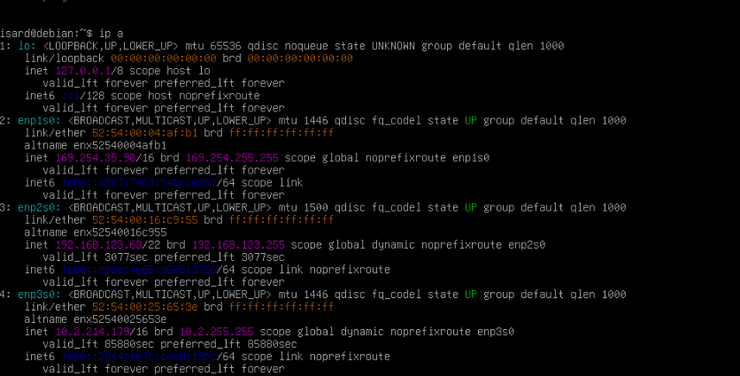

**2. Comprobación de `sshd` y rutas.** `sshd` escucha en `0.0.0.0:22` y no hay reglas de firewall bloqueando.

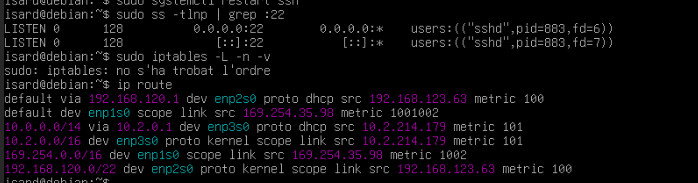

**3. Problema de DNS y solución.** `apt update` fallaba con *"error temporal en resoldre deb.debian.org"*. El `ping 8.8.8.8` funcionaba (hay conectividad) pero `/etc/resolv.conf` (generado por `dhcpcd`) estaba vacío. Solución:

```bash
echo "nameserver 8.8.8.8" | sudo tee /etc/resolv.conf
sudo apt update
```

> Nota: `dhcpcd` puede sobrescribir este fichero al reiniciar. Cuando el router `R-N01` ofrezca DNS propio, se configurará allí.

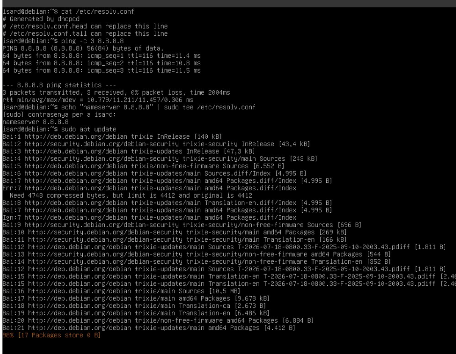

**4. Usuario `bchecker` e instalación de servicios.** La plantilla ya incluye el usuario `isard`, que se mantiene. Se crea `bchecker` con sudo y se instalan `openssh-server` y `vsftpd`:

```bash
sudo adduser bchecker            # contraseña: bchecker121
sudo usermod -aG sudo bchecker
sudo apt install -y openssh-server vsftpd
```

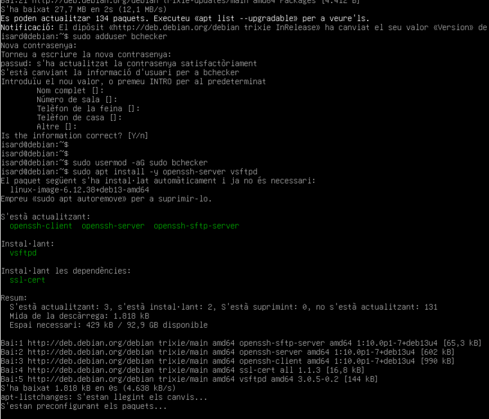

**5. Servicios habilitados en el arranque:**

```bash
sudo systemctl enable --now ssh vsftpd
```

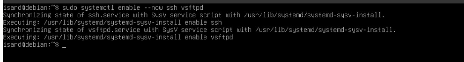

**6. Hostname.** La plantilla arranca con el nombre `debian`; según el enunciado debe ser `F-N03`:

```bash
sudo hostnamectl set-hostname F-N03
sudo nano /etc/hosts        # 127.0.1.1  F-N03
```

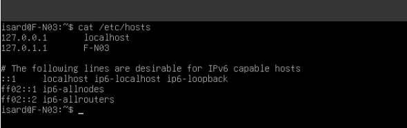

**7. Configuración inicial de `vsftpd` (por defecto).** Antes de modificar nada se revisa la configuración que trae el paquete. Por defecto no permite escritura (`write_enable` ausente), no enjaula a los usuarios (`chroot_local_user` ausente), no define puertos pasivos y el usuario anónimo ya está deshabilitado:

```bash
sudo grep -v '^#' /etc/vsftpd.conf | grep -v '^$'
```

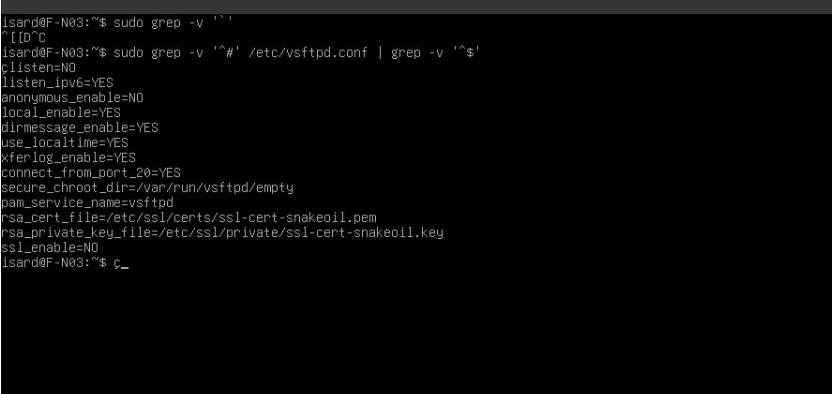

**8. Configuración final de `vsftpd`.** La configuración se guarda en el repositorio ([`config/F-N03/vsftpd.conf`](../../config/F-N03/vsftpd.conf)) y se aplica con un script ([`scripts/F-N03-vsftpd.sh`](../../scripts/F-N03-vsftpd.sh)) que hace copia de seguridad de la configuración original (`/etc/vsftpd.conf.bak`), instala la nueva, crea la lista de usuarios permitidos y reinicia el servicio. Así el despliegue es reproducible y queda versionado en Git.

Cambios respecto a la configuración por defecto:

| Directiva | Valor | Motivo |
|---|---|---|
| `listen` / `listen_ipv6` | `YES` / `NO` | `vsftpd` solo permite una de las dos; se usa IPv4 |
| `anonymous_enable` | `NO` | Sin acceso anónimo |
| `write_enable` | `YES` | Permite subir y modificar ficheros (por defecto no se puede) |
| `local_umask` | `022` | Permisos por defecto de los ficheros subidos |
| `chroot_local_user` | `YES` | Cada usuario queda enjaulado en su directorio personal |
| `allow_writeable_chroot` | `YES` | Necesario para que el usuario pueda escribir en su carpeta enjaulada. Es un compromiso aceptado en el laboratorio |
| `pasv_enable`, `pasv_min_port`, `pasv_max_port` | `YES`, `40000`, `40100` | Modo pasivo con rango acotado, para poder abrirlo en el firewall |
| `userlist_enable`, `userlist_file`, `userlist_deny` | `YES`, `/etc/vsftpd.userlist`, `NO` | Solo pueden entrar por FTP los usuarios de la lista (`bchecker`) |
| `ssl_enable` | `NO` | El cifrado TLS se deja para la mejora de certificados |

**Despliegue en la VM** (el repositorio es público, basta con clonarlo):

```bash
sudo apt install -y git
git clone https://github.com/itb2526-SerhiiYasynskyi/P0.0-ASIXc2A-G01.git
cd P0.0-ASIXc2A-G01
sudo bash scripts/F-N03-vsftpd.sh
```

Para recibir cambios posteriores del repositorio: `git pull`.

**Comprobación:**

```bash
curl -u bchecker:bchecker121 ftp://localhost/
```

**Pendiente:** captura de la ejecución del script y de la comprobación, e IP estática en la DMZ.

### 3.5 BBDD B-N04

**Creación de la VM:** plantilla *Debian 13 Server* de IsardVDI. Red asignada: `ASIXc2-ITB1a` (Intranet), más `Default` de forma temporal para instalar paquetes.

**1. Usuario `bchecker`.** La plantilla ya incluye el usuario `isard`, que se mantiene. Se crea `bchecker` y se añade al grupo `sudo`:

```bash
sudo adduser bchecker            # contraseña: bchecker121
sudo usermod -aG sudo bchecker
```

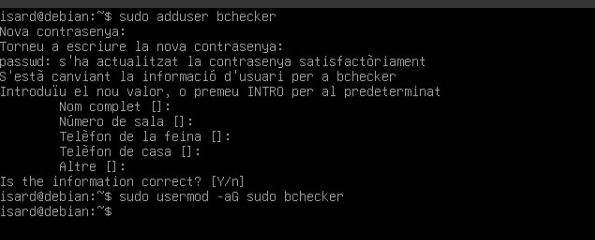

**2. Hostname.** Se cambia el nombre de `debian` a `B-N04`:

```bash
sudo hostnamectl set-hostname B-N04
sudo nano /etc/hosts        # 127.0.1.1  B-N04
```

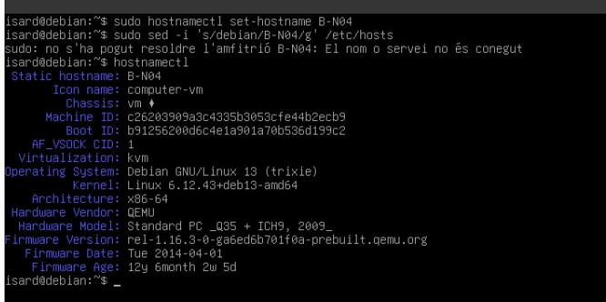

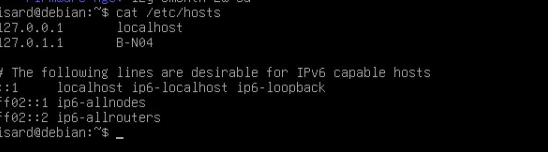

**3. Verificación del usuario e interfaces.** `bchecker` pertenece al grupo `sudo`. `enp1s0` (`Default`) recibe `192.168.121.46/22` por DHCP; `enp2s0` (`ASIXc2-ITB1a`, Intranet) no recibe IPv4 porque no hay DHCP en esa red todavía (pendiente IP estática).

```bash
id bchecker
ip a
```

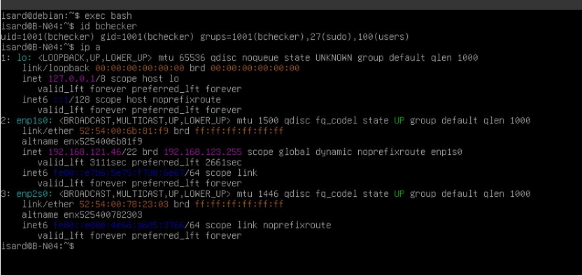

**Pendiente:** instalación de MySQL, carga del CSV de equipamientos educativos, estructura de tablas (relaciones 1-m, n-m tras segmentación) e IP estática en la Intranet.

### 3.6 Clientes C-N05 / C-N06
_Configuración de red, verificación DNS/DHCP._

## 4. Credenciales

- Usuario estándar en todos los equipos: `bchecker` / `bchecker121` (con sudo)

## 5. Mantenimiento

- Cómo reiniciar cada servicio
- Cómo actualizar el sistema
- Logs importantes y dónde están

## 6. Plan de prevención de riesgos (RA3)

| Riesgo | Probabilidad | Impacto | Medida preventiva |
|---|---|---|---|
| Caída del router (R-N01) | | | |
| Pérdida de datos en BBDD | | | |
| Acceso no autorizado vía FTP | | | |
| Fallo de disco en una VM | | | |

## 7. Copias de seguridad y recuperación

_Qué se respalda, cada cuánto, cómo restaurar (joc de pruebas: contingencia)._

## 8. Pruebas realizadas (joc de proves)

- Automatización: _..._
- Contingencia: _..._
- Monitorización: _..._
- Seguridad: _..._

## 9. Mejoras aplicadas (bonus)

- [ ] Segmentación BBDD
- [ ] API REST (Flask)
- [ ] Honeypot en DMZ
- [ ] Script de despliegue automatizado
- [ ] SSH con port knocking
- [ ] Certificados TLS + dominio público
